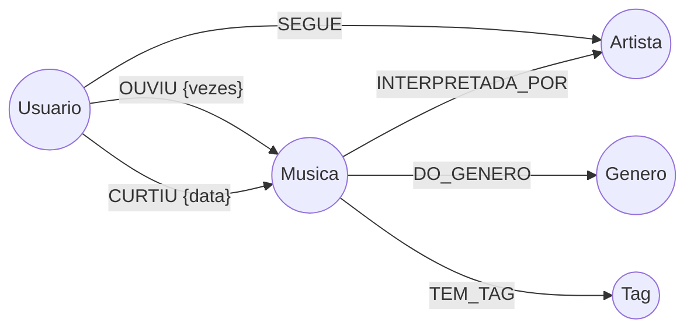

# 🎵 Recomendação de Músicas com Grafos (Neo4j)

Desafio de projeto DIO, trilha Neo4j Certification: um sistema que recomenda faixas a partir de padrões de escuta, curtidas e artistas seguidos.

## Por que grafos?
Recomendação é, por natureza, um problema de **conexões**: "quem ouviu X também ouviu Y". Em SQL isso viraria vários self-joins na tabela de execuções. Em Cypher é só um padrão de caminho:
`(eu)-[:OUVIU]->(m)<-[:OUVIU]-(outro)-[:OUVIU]->(rec)`.

## Modelo do grafo



| Label | Propriedades | Chave |
|---|---|---|
| Usuario | id, nome, cidade | id |
| Musica | track_id, nome, ano | track_id |
| Artista | nome | nome |
| Genero | nome | nome |

> Inclua aqui o print de `CALL db.schema.visualization()`.

## Dataset
A pasta `data/` traz uma **amostra sintética** (12 usuários, 36 músicas, cerca de 90 execuções), gerada com perfis de gosto para que as recomendações façam sentido. Os campos seguem o dataset do Kaggle *Million Song Dataset + Spotify + Last.fm* (`track_id`, `name`, `artist`, `tags`, `year` e o histórico `user_id`, `track_id`, `playcount`). Assim, dá para trocar a amostra pela base real adaptando apenas os nomes das colunas.

### Base real (Kaggle)
Fonte: [Million Song Dataset + Spotify + Last.fm](https://www.kaggle.com/datasets/undefinenull/million-song-dataset-spotify-lastfm), com 50.683 músicas (metadados, tags e atributos de áudio do Spotify) e cerca de 9,7 milhões de registros de escuta (`user_id`, `track_id`, `playcount`).

O script `scripts/preparar_kaggle.py` gera os CSVs em `data_kaggle/`:
- **Catálogo completo**: todas as músicas e artistas, as 30 tags mais frequentes e os atributos de áudio (o vetor `audio`).
- **Amostra de usuários** com 20 ou mais músicas, sorteados até caber no limite do AuraDB Free (200 mil nós e 400 mil relacionamentos). Com `--full`, gera a base inteira para o Neo4j Desktop.
- **Proxies**: o dataset só registra execuções. Por isso `CURTIU` = ouviu a música 5 ou mais vezes, e `SEGUE` = ouviu 3 ou mais músicas do artista.

```
python scripts/preparar_kaggle.py <pasta_do_kaggle> data_kaggle
```
Depois rode `cypher/02b_carga_kaggle.cypher` no lugar de `02_carga.cypher`.

## Como executar
1. Crie uma instância no Neo4j Aura (ou no Neo4j Desktop).
2. Os scripts já leem os CSVs direto deste repositório (links raw do GitHub).
3. Rode, nesta ordem: `cypher/01_constraints.cypher` → `cypher/02_carga.cypher`.
4. Escolha um usuário (`:param usuario => 'U01'`) e rode as queries de `cypher/03_queries.cypher`.

## Perguntas de negócio
| # | Pergunta | Técnica |
|---|---|---|
| Q1 | O que ouvem as pessoas com gosto parecido com o meu? | Filtragem colaborativa |
| Q2 | O que mais existe nos gêneros que eu mais escuto? | Baseada em conteúdo |
| Q3 | Que faixas dos artistas que sigo eu ainda não ouvi? | Navegação direta |
| Q4 | Quem são os usuários mais parecidos comigo? | Jaccard em Cypher puro |
| Q5 | O que recomendar para um usuário novo? | Popularidade (cold start) |
| Q6–Q8 | Similaridade, centralidade e comunidades | GDS: Node Similarity, PageRank, Louvain |

> Adicione os prints das visualizações de cada query.

## Análise exploratória → decisões do modelo
Queries em `cypher/04_exploracao.cypher`, rodadas sobre a amostra Kaggle (4.570 usuários, 50.683 músicas, 174.624 escutas).

| Achado | Evidência | Decisão |
|---|---|---|
| Matriz muito esparsa | densidade de 0,075%, com 38 músicas por usuário (E1) | Modelo **híbrido**: colaborativa sozinha não basta |
| Pouco histórico por usuário | 49% dos usuários têm de 20 a 29 músicas (E2) | Colaborativa com mais peso só a partir de cerca de 30 músicas |
| Cold start de itens | 65% das músicas não têm ouvintes (E3) | Essas músicas só entram via **conteúdo** (tags + áudio) |
| Feedback implícito assimétrico | mediana de 1 execução, p90 de 5, máximo de 420 (E4) | Peso `log(1 + vezes)`; "curtiu" = p90 (5+) |
| Gênero cobre pouco | 44% das músicas têm gênero, 77% têm tag, 100% têm áudio (E5) | Conteúdo baseado em **tags + vetor de áudio**, gênero como apoio |
| Viés de popularidade | Rock alcança 98% dos usuários e é dominante para 70% (E6, E7) | **Penalizar popularidade** no ranking |
| Perfis distintos | 2.159 mistos, 2.047 especialistas, 364 ecléticos (E8) | Pesos diferentes por perfil (abaixo) |
| Ninguém ouve tudo | máximo de 10 dos 15 gêneros; a maioria ouve de 3 a 5 (E9) | Espaço para descoberta controlada |
| Co-escuta contaminada pelo Rock | os 6 maiores pares de gêneros envolvem Rock (E10) | Medir afinidade com **lift/Jaccard**, não com contagem bruta |
| Áudio separa os extremos | Metal/Punk com energia de 0,85, New Age com 0,39; BPM quase constante (E11) | Vetor de áudio útil sem BPM; nos gêneros mainstream, combinar com tags |

### Arquitetura proposta (híbrida)
1. **Geração de candidatos**
   - Colaborativa item-item (co-escuta ponderada por `log(1+vezes)`)
   - Conteúdo: similaridade de tags + cosseno do vetor `audio`
   - Popularidade (só para usuários novos)
2. **Ranking**: `score = a·colaborativa + b·conteúdo − c·log(ouvintes) + d·diversidade`
3. **Pesos por perfil**
   | Perfil | Estratégia |
   |---|---|
   | Especialista (70% ou mais em um gênero) | conteúdo alto, dentro do gênero |
   | Misto | colaborativa e conteúdo equilibrados |
   | Eclético | colaborativa + descoberta via gêneros afins (lift) |
   | Novo (menos de 20 músicas) | popularidade penalizada + conteúdo |
4. **Avaliação**: holdout de 20% das escutas de cada usuário. Métricas: Precision@10, Recall@10, **cobertura do catálogo** e **novidade**, para medir se o viés do Rock foi contido.
5. **Próximo passo (Desktop + GDS)**: embeddings FastRP + KNN para substituir as similaridades manuais.

## Neo4j × TypeDB: o que muda na modelagem
| | Neo4j | TypeDB |
|---|---|---|
| Schema | Opcional; inferido dos dados | Obrigatório (`define` em TypeQL) |
| Garantias | Constraints de unicidade e existência | Tipagem forte de entidades, relações e papéis |
| Relações | Binárias, direcionadas, com propriedades | N-árias, com papéis nomeados |
| Algoritmos de grafo | GDS (PageRank, Louvain…) | Regras/funções de inferência |

Aqui, as constraints de `01_constraints.cypher` fazem o papel mais próximo de um schema.

## Troubleshooting
<!-- Registre as dificuldades reais, por exemplo: -->
- `LOAD CSV` no Aura só aceita URL pública (raw do GitHub), não arquivo local.
- Os procedimentos `gds.*` não existem em instâncias sem o plugin Graph Data Science.
- …

## Estrutura
```
data/      musicas, usuarios, ouviu, curtiu, segue (.csv)
cypher/    01_constraints · 02_carga · 03_queries
```